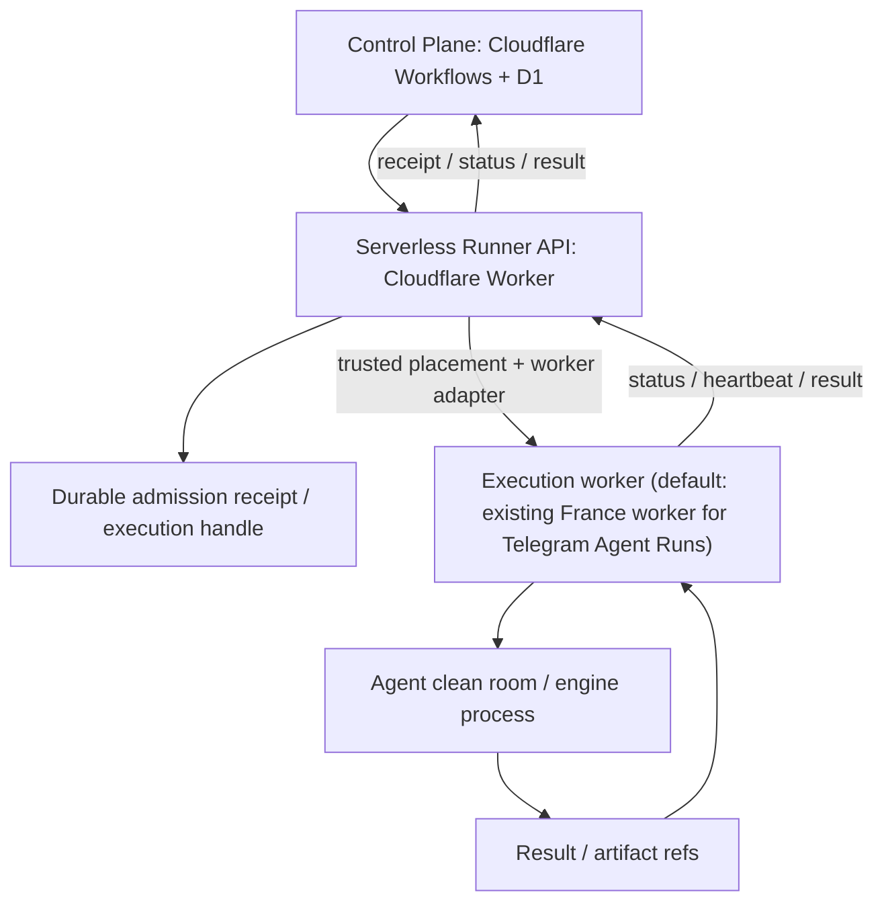

# Serverless Agent API

Статус: нормативная спецификация Serverless Runner API · уточнена владельцем 09.10.2026. API размещается как Cloudflare Worker и предоставляет продуктовый режим **agent execution as a service**. Постоянный execution worker может использоваться за API; он не является API endpoint и не вызывается Control Plane напрямую.

## Граница и минимальный путь

Клиент с ключом/scopes заказывает один ai-agent-job: Control Plane → authenticated Cloudflare Runner API Worker → durable admission receipt → trusted placement → execution worker → Agent clean room → result/status/artifacts → polling либо callback. API Worker выполняет admission, auth, idempotency, policy/placement и durable status; он не запускает длительный процесс агента. Worker adapter вызывает выбранный execution worker и принимает status/result callbacks. В продуктной установке admission может подключиться через общий Input/typed Router/Output; наружу детали не выдаются.

Отдельная поставка Runner должна работать без Telegram, Web UI, GTD, playbook registry и error watcher. Небольшое состояние запросов и результат/receipt нужны даже в standalone; этот admission/result adapter не превращается в платформенный GTD. Runner остаётся владельцем process/clean room lifecycle, не истории всех пользовательских задач.

Runner API имеет один versioned contract для platform и standalone callers. Control Plane обращается к API, а не к физическому worker, VM, GitHub Actions workflow или внутреннему launcher. Worker/engine selection и placement принадлежат Runner API и его trusted policy. Для штатного Telegram Agent Run первым выбирается существующий worker во Франции; GHA worker используется как резерв только при проверенном отказе до admission. После принятия либо неоднозначного исхода повторный запуск на GHA запрещён, пока Runner API не reconciles исходный attempt. CP передаёт только разрешённые logical constraints/RunSpec поля и не получает worker URL или credential. GHA config repository доступен только самому GHA worker и не является workspace запуска; France worker и Runner API его не читают. Бизнес-эскалация до OpenCode относится к Task Router платформы; фактический engine admission проверяется Runner API по его policy.

API Worker остаётся stateless между вызовами исполнения; receipt, admission/idempotency keys, worker handle и terminal status сохраняются в durable Cloudflare binding. Долгоживущий engine и clean room работают вне Worker на выбранном executor. События от worker возвращаются через аутентифицированный callback/status adapter. При сбое API или worker повторная доставка сверяется по тому же operationId/runId; timeout не создаёт новую попытку автоматически.

## Логический API

| Действие | Семантика |
|---|---|
| submit | scoped prompt/input refs, engine policy, limits, output destination, idempotency key → durable accepted receipt |
| status | queued/starting/running/awaiting_user/finalizing/succeeded/failed/cancelled; connection_lost как отдельное состояние наблюдения, export state |
| cancel | requested receipt; terminated — отдельное подтверждение |
| result | outcome, artifact manifest, доступные logs, ошибки экспорта |
| events | ordered replay с cursor/sequence |
| callback | authenticated delivery с eventId, bounded retries и статусом доставки |

Public receipt: requestId/userTaskId для одной клиентской задачи; runId — отдельная попытка. Retry меняет runId; idempotency повтор submit возвращает прежний receipt. Standalone adapter может назвать public поле requestId, но в platform mapping оно однозначно соответствует userTaskId. Callback destinationRef отдельно от integrationBindingId provider операции.

### Live run status and output

Все клиенты (Control Plane, agent/MCP и Web) наблюдают один run через `GET /v1/runs/{runId}/events`; API сохраняет существующий JSON page и дополнительно поддерживает `Accept: text/event-stream`. Не создавать отдельный websocket/SSE state machine для каждого клиента.

- Без cursor SSE начинает с актуального `snapshot` с `id=sequence`, затем передает новые события. При reconnect клиент передает `Last-Event-ID` (для JSON — `cursor`) и получает более поздние события из того же журнала.
- События имеют стабильный `eventId`, возрастающий per-run `sequence`, `timestamp`, `runId`, `ownerGeneration`, `type` и типизированный payload. Повторная доставка допускается; exactly-once transport не обещается. Порядок и cursor позволяют дедуплицировать и продолжить.
- Минимальные наблюдаемые фазы: `run_queued`, запуск/phase OpenCode, подтвержденный process start, worker progress/heartbeat как отдельный signal, доступные OpenCode stdout/stderr или публичные assistant output, `run_finalizing`, export/artifact outcome и terminal outcome. Не выдумывать процент выполнения; не отправлять hidden reasoning, secrets или private checkpoints.
- JSON page возвращает `cursor` последнего отданного события, правильный `hasMore`, snapshot и явно обозначенный retention gap. Если cursor уже удален, клиент получает reset/snapshot-required и новую точку продолжения, а не обещание полного replay.
- Retention count/bytes, максимальный event/output размер, heartbeat cadence, client backpressure и лимит наблюдателей объявляются в capabilities. Медленный/отключенный читатель не останавливает и не замедляет запуск без границ; polling остается совместимым fallback.
- Завершенный run возвращает authoritative final answer/result отдельно от потокового вывода. Wait timeout или закрытие SSE/MCP/UI connection не отменяет run. Отмена запуска остается отдельной операцией с подтверждением остановки.

Поток OpenCode начинается у execution worker и проходит через Runner API, который авторизует run, ограничивает/редактирует output, записывает событие и только затем доставляет его потребителю. API не проксирует один недолговечный VM connection как sole source of truth: после disconnect/restart события читаются из durable per-run journal. Cross-repository acceptance: [RUN-STREAM-01](scenarios/interaction/SC-RUN-STREAM-01-opencode-live-run-observation.md); текущий Worker API gap и implementation map — [architecture #278](https://github.com/trained-assist/trained-agent-architecture/issues/278), [Runner #381](https://github.com/trained-assist/ai-agent-runner/issues/381), executor output [Runner #138](https://github.com/trained-assist/ai-agent-runner/issues/138).

Без user folder вход материализуется из разрешённых input refs, выход экспортируется в storage/API destination. При наличии folder — scoped snapshot/version contract. Данные очищаются после подтверждённого экспорта по lifecycle policy; при неудаче export результат не теряется молча.

## Логи и события

[Observability contract](OBSERVABILITY-AND-ERROR-CONTRACT.md) обязателен и standalone adapter: user/tenant context, request/run IDs, error и основные lifecycle events, declared TTL. Для API-only клиента replyContext=web_only/API destination либо explicit unavailable; профиль нельзя потерять из-за отсутствия Telegram. Внешний principal связан с platform profile/binding или эквивалентным scoped account в standalone.

## Clean room и право запуска

API key связан с tenant/principal, allowed engines/tools/regions, credentials bindings и квотами. Engine defaults не предоставляют клиенту произвольный root command, соседние profiles или shared secrets. Подключение user keys — через credential binding, а не prompt.

При текущей политике автоматический агент платформенной эскалации — OpenCode. Явно заказанные клиентом Claude Code/Codex возможны лишь при отдельном разрешённом runtime profile и подходящей зоне; никакой автоматической лестницы OpenCode → Claude/Codex здесь нет.

Caps: concurrent runs, input/output size, runtime deadline, token/cost quota, disk/process resources и storage retention. «Недорогой OpenCode» не означает unlimited capacity или бесплатность любой выбранной модели. Reporting и минимальный technical recovery обязательны; **GTD по умолчанию отсутствует**.

Awaiting user input либо поддерживается данным API/engine profile через durable prompt+response, либо возвращается declared unsupported/blocked policy. Не держать Run бесконечно ожидающим; resume/checkpoint возможности не объявляются универсальными.

## Репозитории

Agent Runner lifecycle — [ai-agent-runner](https://github.com/trained-assist/ai-agent-runner). Serverless admission/result adapter логично начать package в этом repo с versioned contract; дополнительный repo не обязателен без независимого lifecycle.

Прежний Deploy-Playbooks/serverless-ai-agent-run — отдельная историческая инициатива; это не второй активный владелец той же реализации. Нужен inventory и решение о переносе/архивировании перед извлечением кода. Эта документация не объявляет репозитории слитыми.

## Acceptance

No-profile run, two tenants isolation, duplicate submit, worker loss, cancel, late result, export failure, callback retries, missing credentials, region refusal и resource exhaustion. Standalone fixture запускается без GTD/domain/frontend modules. Полный production clean room не подтверждён текущими draft.

## Implementation refinement: direct artifact transfer

Control API остаётся небольшим: artifactId/manifest, version/hash/size/MIME, scoped upload/download session, status и commit receipt. Клиент передаёт/получает bytes напрямую через короткоживущие signed object URLs; большой upload — multipart/resume с abort/expiry cleanup. FTP, mount пользовательского host directory и большие bodies через Worker не нужны.

Manifest публикуется после export commit; partial/failed exports явны. No-profile request всё равно имеет tenant/principal ownership. Auth проверяется при выдаче session; signed URL чувствителен и не пишется в общие logs. Test fixtures проверяют browser CORS, expiry, interrupted transfers, digest mismatch, wrong scope и folder version conflict. Source HTML можно доставить как файл; publishing/serving untrusted page — отдельная capability.

[Cloudflare direct signed URLs](https://developers.cloudflare.com/r2/api/s3/presigned-urls/), [large object upload](https://developers.cloudflare.com/r2/objects/upload-objects/), [browser CORS](https://developers.cloudflare.com/r2/buckets/cors/) — primary sources для выбранного adapter. [Sandbox approach](ENGINEERING-APPROACH.md) включает local storage fixture и separate cloud smoke.

## Потеря связи, повторный запуск и сохранение данных

Правила — [архитектура, раздел 4.6](ARCHITECTURE.md#46-связка-workflow--runner--рабочие-данные). Разрыв API/worker связи не означает failed/stopped и не запускает вторую попытку автоматически. Status/events показывают connection_lost, last observed state и время наблюдения; после восстановления доступен replay.

Повторный запуск требует отдельного авторизованного сигнала, привязанного к userTaskId и ожидаемой попытке/generation, с необязательными дополнительными инструкциями. Повтор submit с прежним idempotency key остаётся чтением прежнего receipt. До нового Run сверяем старый процесс и внешние действия, исключаем дальнейшие записи старого исполнителя. Новый runId сохраняет userTaskId и получает разрешённые workspace/checkpoint/artifact refs.

Рабочий volume переживает процессы; агент может сохранить тяжёлый файл локально. После engine exit Runner завершает export в finalizing. Клиент видит outcome процесса отдельно от export progress/error; обязательный результат становится доступен после commit. Повтор export не повторяет агентскую работу. Единственная копия не удаляется до подтверждённого сохранения; cleanup/retention отдельно. Потеря VM и потеря persistent volume проверяются разными сценариями.
